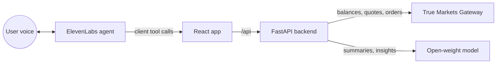

# Talk-to-Trade

Check your crypto portfolio and place trades by voice. Ask "How's my
portfolio?" and hear a briefing; say "Buy five dollars of ETH", hear the quote,
say "Confirm", and the trade executes on the True Markets Gateway.

Built at **Tech@NYU Shipyard Buildathon** on Oct 24, 2026.

- **Voice**: ElevenLabs Agents (speech-to-text, text-to-speech, tool calling)
- **Trading**: True Markets Gateway API (`truemarkets` Python SDK)
- **Analysis**: an open-weight model, Qwen 2.5 7B, served through Ollama locally

> Educational demo. Trades are capped and always require confirmation. Not financial advice.

## How it works



1. The browser runs the ElevenLabs agent. When the agent wants data or a trade,
   it calls a **client tool** in the browser (`frontend/src/AgentTools.tsx`).
2. Each tool calls the FastAPI backend, which holds all keys and all safety rules.
3. Trades always take two calls: `prepare_trade` returns a quote and a
   confirmation id that the agent reads aloud, and only `confirm_trade`
   executes it. Quotes expire after 30 seconds and can only be used once.
4. The backend enforces an asset allowlist, a $10 per-trade cap, a $40 daily
   cap and balance checks. The model never places trades directly.

## Quick start

You need Python 3.10+, Node 20+, and (for summaries) [Ollama](https://ollama.com).
Everything runs in **mock mode** by default: fake balances and prices, no keys
needed.

### 1. Backend

```bash
cd backend
python -m venv .venv && source .venv/bin/activate   # Windows: .venv\Scripts\activate
pip install -r requirements.txt
cp .env.example .env
uvicorn app.main:app --reload --port 8000
```

Check it with <http://localhost:8000/api/health> and <http://localhost:8000/docs>.
Run the tests with `pytest -q`.

### 2. Open-source model

```bash
ollama pull qwen2.5:7b-instruct
ollama serve            # if it isn't already running
```

If the model isn't running, the backend falls back to a template summary, so
nothing breaks while you set it up. Any OpenAI-compatible server works; change
`LLM_BASE_URL` and `LLM_MODEL` in `backend/.env`.

### 3. ElevenLabs agent

1. Create an agent at <https://elevenlabs.io/app/agents>.
2. Paste the prompt from [`agent/system_prompt.md`](agent/system_prompt.md).
3. Add the seven client tools from [`agent/tools.md`](agent/tools.md), each with **Wait for response** on.
4. Copy the agent ID.

### 4. Frontend

```bash
cd frontend
npm install
cp .env.example .env.local     # paste your VITE_ELEVENLABS_AGENT_ID
npm run dev
```

Open <http://localhost:5173>, press **Talk**, and allow the microphone.

### 5. Go live with True Markets

1. Get your API key JSON file from the True Markets reps or truemarkets.co → Settings → API Keys.
2. In `backend/.env`, set `TM_KEY_FILE` to the file's absolute path (keep the file **outside** the repo).
3. Run the read-only check: `python scripts/smoke_test_truemarkets.py` (places no orders).
4. Set `BROKER_MODE=live` and restart the backend. The portfolio badge turns green.

## API

| Method | Path | What it does |
| --- | --- | --- |
| GET | `/api/health` | Mode, model and limits |
| GET | `/api/portfolio` | Holdings valued in USD with weights |
| GET | `/api/brief` (alias `/api/summary`) | Good-morning brief: portfolio, 24h moves, spoken text from the open model |
| POST | `/api/advise` | `{question, asset?, usd_amount?, percent_of_portfolio?}` → portfolio-impact analysis plus spoken guidance (pros, risks, a guiding question) |
| GET | `/api/insights` | Educational observations from the open model |
| GET | `/api/price/{asset}` | Current price |
| POST | `/api/trades/prepare` | `{asset, side, usd}` → quote and `confirmation_id` (nothing executes) |
| POST | `/api/trades/execute` | `{confirmation_id}` → places the order |
| POST | `/api/trades/cancel` | `{confirmation_id?}` → drops the pending quote |
| GET | `/api/trades` | Pending quote and trade history |

Most responses include `say`: a sentence the agent can read aloud verbatim.

## Repo map and owners

| Area | Files | Owner |
| --- | --- | --- |
| Trading and guardrails | `backend/app/broker.py`, `backend/app/trades.py` | _name_ |
| API and portfolio | `backend/app/main.py`, `backend/app/portfolio.py` | _name_ |
| Open model and prompts | `backend/app/llm.py` | _name_ |
| Voice agent | `agent/`, `frontend/src/AgentTools.tsx` | _name_ |
| UI | `frontend/src/App.tsx`, `frontend/src/components.tsx`, `frontend/src/styles.css` | _name_ |


## Demo script (3 minutes)

1. "Good morning, Ticker." (morning brief from the open model)
2. "I'm thinking about putting 30% of my portfolio into NVIDIA. Any suggestions?" (guidance: pros, risks, a guiding question; the Before you invest card appears)
3. "Buy five dollars of ETH." The quote is read back. "Confirm." The trade executes live.
4. Show the trade log and the updated portfolio, then the architecture slide.

## License

[MIT](LICENSE)
