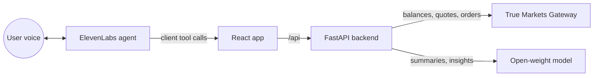

# VoiceAdvisor

Check your crypto/investments portfolio and place trades by voice. Ask "How's my
portfolio?" and hear a briefing; say "Buy five dollars of ETH", hear the quote,
say "Confirm", and the trade will execute on the True Markets Gateway.

Built at **Tech@NYU Shipyard Buildathon** on Oct 24, 2026.

Tech stack:
- **Voice**: ElevenLabs Agents (speech-to-text, text-to-speech, tool calling)
- **Trading**: True Markets Gateway API (`truemarkets` Python SDK)
- **Analysis**: an open-weight model, Qwen 2.5 7B, served through Ollama locally

Note that this is an educational demo, trades are capped and always require confirmation. Analysis is not to be treated as financial advice.

## How it works

1. The browser runs the ElevenLabs agent. When the agent wants data or a trade,
   it calls a **client tool** in the browser (`frontend/src/AgentTools.tsx`).
2. Each tool calls the FastAPI backend, which holds all keys and all safety rules.
3. Trades always take two calls: `prepare_trade` returns a quote and a
   confirmation id that the agent reads aloud, and only `confirm_trade`
   executes it. Quotes expire after 30 seconds and can only be used once.
4. The backend enforces an asset allowlist, a $10 per-trade cap, a $40 daily
   cap and balance checks. The model never places trades directly.

## API

| Method | Path | What it does |
| --- | --- | --- |
| GET | `/api/health` | Mode, model and limits |
| GET | `/api/portfolio` | Holdings valued in USD with weights |
| GET | `/api/brief` (alias `/api/summary`) | Good-morning brief: portfolio, 24h moves, spoken text from the open model |
| POST | `/api/advise` | `{question, asset?, usd_amount?, percent_of_portfolio?}` → portfolio-impact analysis plus spoken guidance (pros, risks, a guiding question) |
| GET | `/api/insights` | Educational observations from the open model |
| GET | `/api/price/{asset}` | Current price |
| POST | `/api/trades/prepare` | `{asset, side, usd}` → quote and `confirmation_id` (nothing executes) |
| POST | `/api/trades/execute` | `{confirmation_id}` → places the order |
| POST | `/api/trades/cancel` | `{confirmation_id?}` → drops the pending quote |
| GET | `/api/trades` | Pending quote and trade history |

Most responses include `say`: a sentence the agent can read aloud verbatim

## Repo map and owners

| Area | Files |
| --- | --- |
| Trading and guardrails | `backend/app/broker.py`, `backend/app/trades.py` |
| API and portfolio | `backend/app/main.py`, `backend/app/portfolio.py` |
| Open model and prompts | `backend/app/llm.py` |
| Voice agent | `agent/`, `frontend/src/AgentTools.tsx` |
| UI | `frontend/src/App.tsx`, `frontend/src/components.tsx`, `frontend/src/styles.css` |

## License

[MIT](LICENSE)
